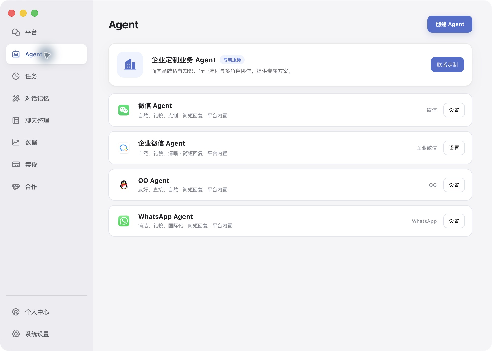
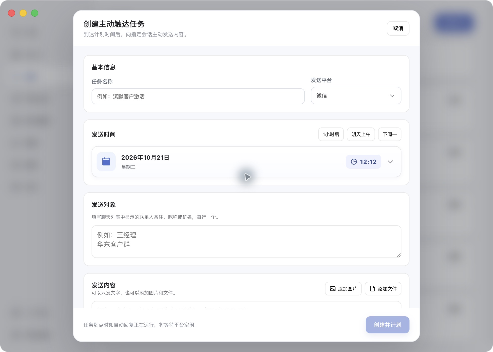
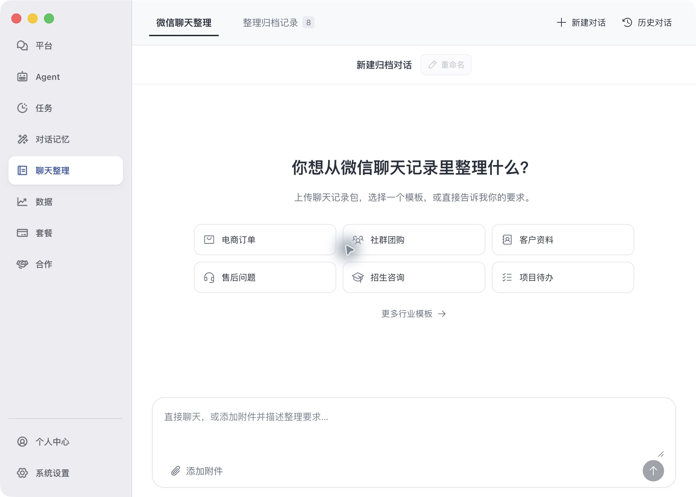

# 功能与新版界面

以下工作台截图于2026年10月21日采集自 macOS 版一见AI 1.0.39，展示的是配置界面。产品视频保留原始素材，界面可能与新版不同。

## 四平台接入业务 Agent

支持个人微信、企业微信、QQ、WhatsApp。各平台可分别选择Agent、设置回复范围和服务时间；同一个业务Agent也可用于多个平台。

## 按岗位配置 AI 员工

按销售、客服、售后、社群等业务配置工作身份、服务范围、语气和回复长度。创建界面支持模板选择、多平台选择和AI优化服务范围表述。

## 知识库与可发送内容

业务知识帮助Agent理解产品、服务和规则；可发送内容单独管理要发给客户的图片和文件。两者用途不同，需要分别配置。

## 上下文理解与人工接手

Agent结合当前可见消息与会话上下文理解连续提问，按需使用知识库与资料。可按业务选择Agent接管或人工辅助，关键情况由人接手。

## 定时主动跟进

创建主动触达任务，指定平台、时间、会话与发送内容，支持文字、图片和文件。可用于客户回访、资料补充、预约提醒等已约定的业务沟通。

## 微信聊天整理与自动归档

上传微信聊天记录包，选择行业模板或描述自己的整理要求，由AI提取并整理业务信息。新版界面提供：

- 电商订单
- 社群团购
- 客户资料
- 售后问题
- 招生咨询
- 项目待办
- 更多行业模板入口

整理结果通过「整理归档记录」管理。实际内容取决于输入的记录、选择的模板和整理要求。

## 回复范围与工作时间

按平台配置名单、群聊规则与服务时间。7×24小时持续工作以电脑、网络、权限、客户端和服务保持可用为前提；关机、睡眠或退出客户端会影响运行。

[返回首页](../README.md) · [配置指南](getting-started.md)
