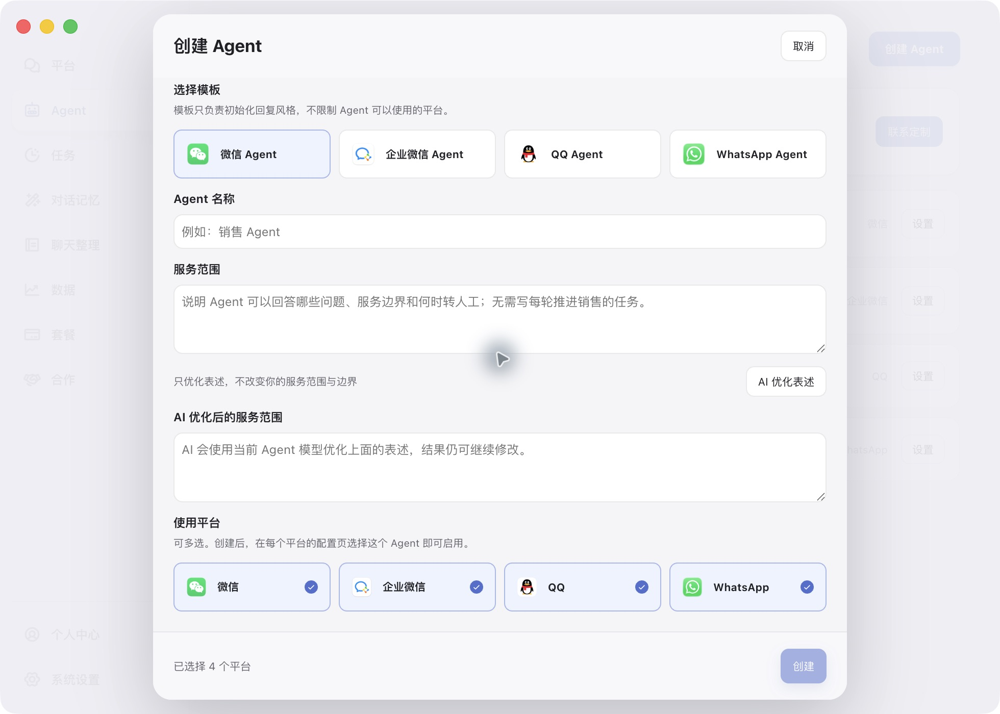
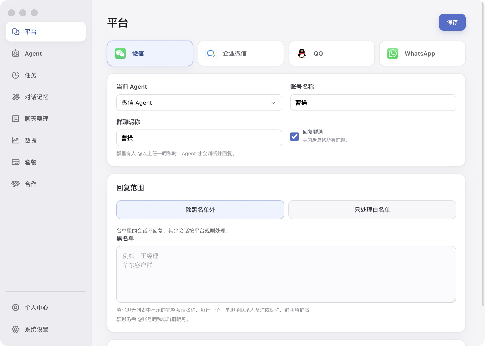

# 配置你的第一个 AI 员工

一见AI支持个人微信、企业微信、QQ、WhatsApp。按下面的顺序完成配置，再用自己的测试会话检查效果。

## 1. 下载与安装

访问[一见AI下载官网](https://gw.chantgpt.cn/?utm_source=github&utm_medium=docs&utm_campaign=yijian_ai)，选择适合你电脑的安装包。具体系统与机型支持以官网当前下载选项为准。

安装后按应用引导登录账号，了解授权与开通方式。需要远程演示可通过[首页末尾的微信二维码](../README.md#添加微信了解一见ai)联系。

## 2. 准备运行环境

- 电脑正常联网，对应聊天客户端已登录。
- 按「系统设置」的引导配置屏幕录制、辅助功能等必要权限。
- 需要持续运行时，保持电脑、聊天客户端、一见AI和相关服务可用。
- WhatsApp的具体客户端与Chrome环境要求，按当前版本安装引导配置。

屏幕录制用于识别界面；辅助功能用于点击、输入等操作。本地界面操作不等于完全离线，模型调用和知识库处理等服务需要网络。

## 3. 创建或选择 Agent

打开「工作台 → Agent」，可使用四个平台内置的Agent，也可点击「创建 Agent」按业务创建。

填写工作身份和服务范围，设置语气与回复长度。新版创建界面可用「AI 优化表述」优化服务范围的表达；阅读结果后再决定使用。创建时选择允许使用的平台，随后在各平台配置页绑定该Agent。

可参考[销售接待模板](../templates/sales-agent.md)或[售后服务模板](../templates/support-agent.md)。这些是面向用户的通用配置示例，不包含内部系统提示词。

## 4. 配置业务知识与可发送资料

在Agent的「知识库与文件」中添加实际业务资料。产品介绍、服务流程、库存规则、配送与退换说明等，应准确并及时更新。

知识库用于回答问题；准备发给客户的图片和文件，需要在可发送内容中单独配置。先检查文件名、内容与用途是否匹配。

## 5. 设置平台规则

在「平台」中选择微信、企业微信、QQ或WhatsApp，选择当前Agent，再配置账号昵称、群聊昵称、回复范围、黑白名单与服务时间。

使用期间保持正确的业务账号登录；名单填写聊天列表中实际显示的会话名称。群聊按应用当前显示的规则配置。

## 6. 测试与启用

先用自己的测试会话检查：普通咨询、连续追问、知识库答案、资料发送、回复范围和人工接手。确认配置符合业务需求后，再选择适合的运行模式启用。

创建主动任务时，先用自己可控的测试对象核对平台、时间、收件会话及附件，再安排实际跟进。

## 7. 整理与归档业务信息

在「聊天整理 → 微信聊天整理」上传聊天记录包，选择行业模板，或输入自己的整理要求。可从[聊天整理指令模板](../templates/chat-archive.md)开始，再通过「整理归档记录」管理结果。

该模块基于提供的聊天记录工作；不要将它理解为无需输入资料即可实时同步所有平台的全部聊天。

[返回首页](../README.md) · [四平台指南](platforms.md) · [常见问题](faq.md)
